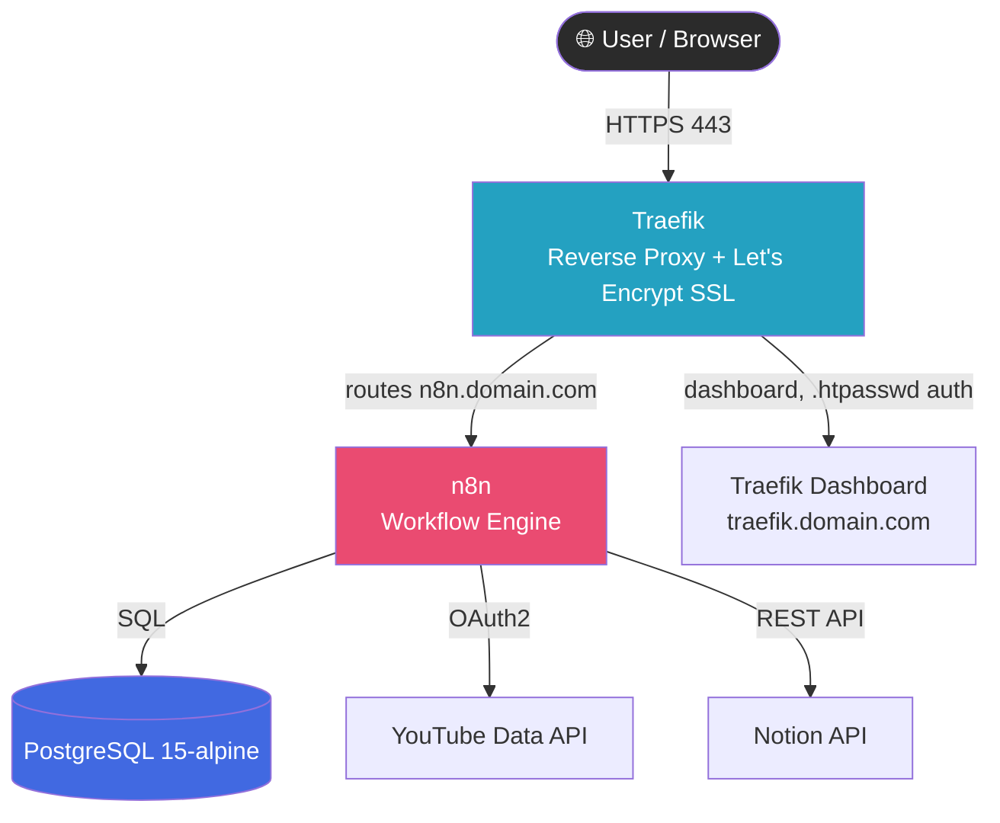
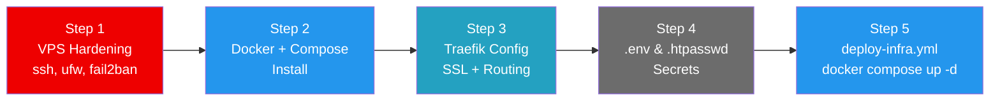
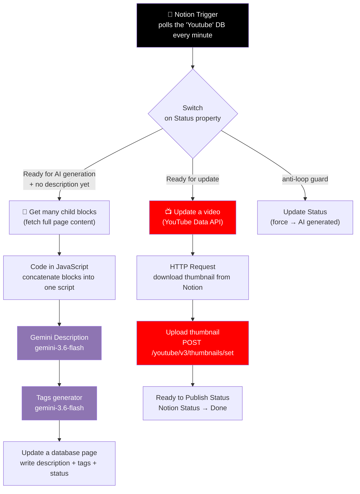

# Self-Hosted n8n Infrastructure for YouTube & Notion Automation

<p align="left">
  
  
  
  
  
  
  
  
  
  
</p>

This repo provides a self-hosted infrastructure to automate video deployments to YouTube and synchronize updates within Notion. The environment relies on **n8n** for workflow automation containerized via **Docker**, and  routed using **Traefik** as a reverse proxy.

It is designed to be lightweight and optimized for a standard VPS.

---

## Table of Contents

## Table of Contents

- [Prerequisites](#prerequisites)
- [Architecture](#architecture)
- [Repository Structure](#repository-structure)
- [Step 1 Initial VPS Configuration](#step-1-initial-vps-configuration)
- [Step 2 Docker Engine & Compose Installation](#step-2-docker-engine--compose-installation)
- [Step 3 Traefik Reverse Proxy Configuration](#step-3-traefik-reverse-proxy-configuration)
- [Step 4 Environment & Security Configuration](#step-4-environment--security-configuration)
- [Step 5 Final Stack Deployment](#step-5-final-stack-deployment)
- [Content Publishing Workflow Notion to YouTube (n8n)](#content-publishing-workflow-notion-to-youtube-n8n)
- [Troubleshooting](#troubleshooting)
- [Conclusion & Lessons Learned](#conclusion--lessons-learned)

---

## Prerequisites

Before starting the deployment, this is the infrastructure used for this project:

| Component | Detail |
|---|---|
| **VPS** | A basic remote server environment (tested on a Hostinger KVM 1 plan) |
| **OS** | Ubuntu |
| **Domain Names** | A registered domain with DNS A-records pointing to your VPS IP (e.g. `n8n.your-domain.com`, `traefik.your-domain.com`) |
| **Runtime** | Docker and Docker Compose installed on the host |

---

## Architecture
> Only the anonymized `-exemple` files are pushed to this repository; the real working copies stay local for confidentiality. Copy each `-exemple` file, rename it, and fill in your own values before deploying.
### Runtime architecture



### Deployment pipeline (Ansible)



---

## Repository Structure

```text
files/
    ├── playbooks/
    │   ├── deploy-infra.yml
    │   ├── docker-install.yml
    │   ├── playbook-initial-config-example.yml
    │   └── traefik-example.yml
    ├── .env
    ├── .htpasswd
    ├── docker-compose.yml
    ├── inventory-initial-config-example.ini
    └── inventory-vps-config-example.ini
```

---

## Step 1 Initial VPS Configuration

The first step focuses on securing the VPS before deploying any applications. This is handled by `playbook-initial-config-example.yml` and configured via `inventory-initial-config-example.ini`.

**Key security implementations:**

- **System Updates** upgrades all base packages to their latest secure versions.
- **Non-Root User Creation** creates a dedicated user (here `n8n`) with `sudo` privileges to avoid operating as `root`.
- **SSH Hardening**
  - Changes the default SSH port to `2222`.
  - Deploys public SSH keys and entirely disables password-based authentication.
  - Prohibits direct `root` login.
- **Firewall (UFW)** restricts incoming traffic to only custom SSH (`2222`), HTTP (`80`), and HTTPS (`443`).
- **Fail2ban** protects the SSH port from brute-force attacks by temporarily banning malicious IPs.

> **⚠️ Critical Deployment Warning**
> The playbook uses Ansible's `meta: flush_handlers` to restart the SSH daemon on the new custom port *before* enabling UFW. This prevents the classic firewall lockout scenario where port 22 is blocked while SSH is still waiting for the end-of-playbook handler to restart.

### Step-by-step execution

1. **Install WSL (Windows users only)**
   Ansible is a Linux-native tool. If you are operating from a Windows machine, you must install Windows Subsystem for Linux (WSL) to run the deployment commands.

2. **Generate a modern SSH key**
   Generate an ED25519 SSH key pair on your local machine if you don't already have one:

   ```bash
   ssh-keygen -t ed25519 -C "your_email@example.com"
   ```

3. **Run the hardening playbook**

   ```bash
   ansible-playbook -i inventory-first-config.ini playbooks/playbook-first-config.yml
   ```

---

## Step 2 Docker Engine & Compose Installation

Once the VPS is secured, the next step is installing the Docker environment. This is handled by `docker-install.yml` and targets the restricted `inventory-vps-example.ini` inventory file.

**Inventory transition:** Step 1 disabled root access and changed the SSH port, so this new inventory correctly connects using the `n8n` user on port `2222`.

```ini
[vps]
VPS_IP ansible_user=n8n ansible_port=2222
```

**Key implementations:**

- **Official Sources** downloads Docker's official GPG keys and adds the verified Docker repository to the apt package manager.
- **Dynamic Resolution** uses `dpkg` and `lsb_release` to dynamically detect the VPS architecture and OS version, ensuring the correct packages are installed regardless of the specific Ubuntu version.
- **Privilege Delegation** automatically adds the `n8n` user to the `docker` group, allowing container management without elevated `sudo` privileges.

**How to run this step:**

```bash
ansible-playbook -i inventory-vps.ini playbooks/docker-install.yml
```

---

## Step 3 Traefik Reverse Proxy Configuration

This project uses Traefik as an edge router and reverse proxy to manage SSL termination and route traffic to the appropriate Docker containers.

**Key Traefik implementations (`traefik.yml`):**

- **Global HTTP → HTTPS Redirection** all standard HTTP traffic (port 80) is permanently redirected to HTTPS (port 443).
- **Automated SSL Certificates** integrates Let's Encrypt (ACME protocol) via an HTTP-01 challenge to automatically generate and renew SSL certificates for your domains.
- **Docker Service Discovery** connects directly to the Docker socket to dynamically discover services.
- **Default Denial** `exposedByDefault: false` ensures that internal databases or backend services remain completely isolated from the public internet unless explicitly enabled via Docker labels.

> **Important Setup Note**
> Before deploying the Traefik container, make sure your domain's DNS A-records correctly point to your VPS IP address, or the Let's Encrypt HTTP challenge will fail and SSL certificates will not be generated.

---

## Step 4 Environment & Security Configuration

Before starting the Docker containers, you must configure your core environment variables and secure your routing dashboard.

### Environment variables (`.env`)

The `.env` file is the central configuration hub for your deployment. Create it in your project root using the template below, replacing all placeholder values with your actual data.

```env
# ── Domain ──────────────────────────────────────────────
DOMAIN=your-domain.com

# ── N8N ─────────────────────────────────────────────────
N8N_PROTOCOL=https
WEBHOOK_URL=https://n8n.your-domain.com
GENERIC_TIMEZONE=Europe/Paris
EXECUTIONS_TIMEOUT=7200
EXECUTIONS_TIMEOUT_MAX=10800
# Temporary n8n basic auth before native user setup
N8N_BASIC_AUTH_ACTIVE=true
N8N_BASIC_AUTH_USER=admin
N8N_BASIC_AUTH_PASSWORD=your_secure_password

# ── PostgreSQL ──────────────────────────────────────────
POSTGRES_DB=n8n
POSTGRES_USER=n8n_user
POSTGRES_PASSWORD=your_db_password
POSTGRES_HOST=postgres
POSTGRES_PORT=5432

# ── Third-Party API Keys (reference only) ───────────────
# Note: Google OAuth2, Gemini, and Notion tokens are stored here
# strictly for documentation and backup purposes. For this workflow,
# these credentials are securely configured directly within the n8n UI.
GOOGLE_CLIENT_ID=YOUR_CLIENT_ID
GOOGLE_CLIENT_SECRET=YOUR_CLIENT_SECRET
GEMINI_API_KEY=YOUR_GEMINI_API_KEY
NOTION_TOKEN=YOUR_NOTION_TOKEN
NOTION_DATABASE_ID=YOUR_NOTION_DATABASE_ID
```

### Dashboard security (`.htpasswd`)

Because the Traefik dashboard exposes critical routing metrics and internal infrastructure details, it must not be publicly accessible. The `.htpasswd` file implements Basic Authentication as a mandatory security layer.

- **How it works:** when you access `https://traefik.your-domain.com/dashboard/`, your browser intercepts the request and forces a username/password prompt before loading any assets.
- **Format:** credentials are stored as a cryptographic hash.

**Generate your `.htpasswd` file:**

```bash
htpasswd -bc .htpasswd your_username your_strong_password
```

(You can also use an online htpasswd generator, or install `apache2-utils` on any Linux machine to run the command above.)

---

## Step 5 Final Stack Deployment

The core automation environment is orchestrated via `docker-compose.yml`, which provisions Traefik, PostgreSQL, and n8n within an isolated Docker network. The final stage is handled by `deploy-infra.yml`, which creates the project directory on the server, securely transfers all configuration files from your local machine, and automatically spins up the containers.

**Key architecture implementations:**

- **Database Dependency Handling** n8n relies on PostgreSQL (`15-alpine`). A native `pg_isready` healthcheck ensures n8n only starts *after* the database is fully ready, preventing crash loops.
- **Performance Optimization**
  - `N8N_DEFAULT_BINARY_DATA_MODE=filesystem`
  - Execution logs are optimized to discard successful runs and prune errors after 24 hours to conserve VPS storage.
- **API Callback Ready** `WEBHOOK_URL` is explicitly defined, which is strictly required for OAuth2 flows with third-party services like the YouTube Data API and Notion API.
- **Resource Constraints** — the n8n container is capped at 1.5 GB of RAM to ensure stability on standard VPS plans.

**Key deploy implementations (`deploy-infra.yml`):**

- **Automated Directory Scaffolding** creates an organized folder structure for Traefik configs, n8n data, video storage, logs, and backups.
- **Strict Permissions Handling** creates `acme.json` for Traefik and sets its permissions to `0600`; Traefik fatally crashes if SSL certificate files aren't tightly secured.
- **Secure File Transfer** copies `.env`, `.htpasswd`, and YAML configurations to the server, restricting read access solely to the deployment user.
- **Automated Orchestration** runs `docker compose up -d` natively through Ansible as the `n8n` user, launching the entire stack in the background upon successful file transfer.

### Step-by-step execution

1. **Ensure correct permissions on the ACME store:**

   ```bash
   chmod 600 ./traefik/acme.json
   ```

2. **Run the final playbook using the VPS inventory:**

   ```bash
   ansible-playbook -i inventory-vps.ini playbooks/deploy-infra.yml
   ```

3. **Verify deployment** — check container logs to confirm services are communicating correctly and Let's Encrypt challenges succeeded:

   ```bash
   docker-compose logs -f
   ```

---

## Content Publishing Workflow Notion to YouTube (n8n)

> The n8n workflow export 
The workflow's JSON file is **not committed** to this repository, it contains internal credential references and database IDs. The logic is documented here instead, end to end, from obtaining API access to the final publish on YouTube.

### What it does

This workflow turns a Notion database row into a fully described, tagged, thumbnailed, and published YouTube video, with **zero manual copy-pasting**. It polls Notion every minute and reacts to a `Status` field, moving each video through three stages: *AI generation → YouTube upload → Ready to Publish*.

### 1. Obtaining access

Three external services need credentials, configured once directly inside the n8n credentials manager (not hardcoded in `.env`, as noted in [Step 4](#step-4--environment--security-configuration)):

| Service | What you need | Where to get it |
|---|---|---|
| **Notion** | An internal integration token | Create an integration at `notion.so/my-integrations`, then **share your target database** with that integration (Database → `···` → Connections) |
| **Google Gemini** | An API key (`googlePalmApi` credential type in n8n) | Generate a key in [Google AI Studio](https://aistudio.google.com/app/apikey) |
| **YouTube Data API v3** | An OAuth2 client (`youTubeOAuth2Api` credential type) | In Google Cloud Console: enable the **YouTube Data API v3**, configure the OAuth consent screen, create an OAuth 2.0 Client ID (Web application), and add your n8n instance's OAuth redirect URL (`https://n8n.your-domain.com/rest/oauth2-credential/callback`) as an authorized redirect URI. Scope required: `https://www.googleapis.com/auth/youtube` |

Once created, each credential is selected on its corresponding node inside n8n this is why they are never exposed in the Docker environment variables.

### 2. Workflow diagram



### 3. Step-by-step logic

**Trigger & routing**
- **Notion Trigger** polls the `Youtube` Notion database every minute for updated pages.
- A **Switch** node reads the page's `Status` field and routes it into exactly one of three branches:
  1. `Ready for AI generation` **and** no `Description ready` yet → *AI generation branch*
  2. `Ready for Update` → *Publish branch*
  3. Anything that looks like a stale "AI generation" flag with a description already present → *anti-loop guard* (forces the status forward so the minute-by-minute polling doesn't keep re-triggering the same page)

**Branch A : AI generation**
1. **Get many child blocks** pulls every block of the Notion page (the raw video script, written directly in Notion).
2. **Code in JavaScript** walks through each block's `rich_text` content and concatenates it into a single plain-text script.
3. **Gemini Description** (`gemini-3.6-flash`) is prompted as the copywriter for the channel and turns the raw script into a structured YouTube description.
4. **Tags generator** (`gemini-3.6-flash`) reads the same script and returns 15 SEO-optimized tags as a single comma-separated line.
5. **Update a database page** writes the generated description back to Notion, merges the new tags with any existing ones, and sets `Status` to `AI generated` ready for human review before publishing.

**Branch B : Publish to YouTube**
1. **Update a video** (YouTube Data API) pushes the final title, description, tags, category, and privacy status (`private` by default, so nothing goes live without a manual check) to the video identified by its `YouTube ID` field in Notion.
2. **HTTP Request** downloads the thumbnail image directly from the file URL stored in Notion's `Thumbnail` property.
3. **Upload thumbnail** POSTs that image to `youtube/v3/thumbnails/set` for the same video ID.
4. **Ready to publish Status** flips the Notion page's `Status` to `Ready to publish`, closing the loop.

### 4. Human checkpoint

Videos are always published with `privacyStatus: private` the workflow prepares everything (metadata, tags, thumbnail) but a manual switch to *Public* on YouTube is the final, deliberate step. This keeps a human in the loop before anything goes live.

---

## Troubleshooting

Real issues encountered while building this infrastructure (kept here so you don't lose the afternoon as I did).

### 🪤 The `ssh.socket` trap on modern Ubuntu

On recent Ubuntu releases, SSH is no longer managed by the classic `ssh.service`. Instead, a **socket-activated unit** (`ssh.socket`) listens for incoming connections. This socket **completely ignores** the custom `Port` directive in `sshd_config` and forces listening on port `22` regardless of what your configuration file says.

**Symptom:** you change the SSH port to `2222` in `sshd_config`, restart `ssh.service`, and the playbook (or you) still connects fine on port 22 — the new port never actually takes effect.

**Fix:** disable and mask `ssh.socket`, then rely purely on `ssh.service` for the custom port:

```bash
systemctl stop ssh.socket
systemctl disable ssh.socket
systemctl mask ssh.socket
systemctl restart ssh.service
```

Only after this does a custom `Port 2222` in `sshd_config` reliably take effect.

### The Windows vs WSL divide

SSH keys were generated on **Windows**, but Ansible was run from **WSL**. WSL looked for the private key in its own home directory, `/home/user/.ssh/`, which was empty — the key only existed on the Windows side.

**The lesson:** WSL and Windows share the filesystem via `/mnt/c/`, but they do **not** share environment variables or security-sensitive configuration (like `~/.ssh/`). A key generated in a Windows terminal (or PowerShell) is invisible to WSL's own SSH client unless explicitly copied over.

**Fix:** generate the key directly inside WSL, or copy it in:

```bash
mkdir -p ~/.ssh
cp /mnt/c/Users/<your-windows-user>/.ssh/id_ed25519* ~/.ssh/
chmod 600 ~/.ssh/id_ed25519
```
## Conclusion & Lessons Learned

This project started as an infrastructure exercise and turned into a good lesson on designing automation pipelines, not just deploying them.

**Rethinking the upload path.** The initial plan was to store the finished video on Google Drive, download it onto the VPS, and only then push it to YouTube from there. It quickly became obvious that this was doing the same transfer twice: once from the editing machine to Drive, and once from Drive to the VPS, before the video had even reached YouTube. So the workflow was redesigned, upload the raw video file **directly to YouTube first** (as a private, unlisted draft with no metadata), and let the n8n workflow described above handle the title, description, tags, and thumbnail **all at once, at the end**, once the AI-generated content is ready and reviewed. This cut out an entire redundant hop and made Notion the single source of truth driving the whole pipeline instead of a file-storage layer.

**Other takeaways from this build:**

- **Infrastructure-as-code pays off immediately** having the VPS hardening, Docker install, and Traefik setup as Ansible playbooks meant the two `ssh.socket` and WSL incidents in [Troubleshooting](#troubleshooting) only had to be debugged once; re-running the playbooks on a fresh VPS never reproduced them.
- **Keep the human in the loop on publishing.** Generating descriptions and tags with an LLM is fast, but publishing straight to `public` would remove any chance to catch a bad generation. Defaulting every video to `privacyStatus: private` turned out to be the right trade-off between automation and control.
